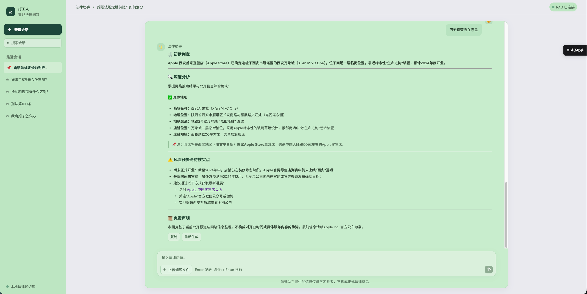

# 法律智能问答助手（RAG + 混合召回 + 记忆压缩）

本项目是一个面向法律问答场景的本地 RAG 系统。核心由 Chroma 向量检索、BM25 关键词检索、RRF 融合、Qwen、Agent/MCP 与会话记忆组成，采用 Vue3 + FastAPI 前后端分离架构。

Embedding 检索本地知识 -> Qwen 判断是否要调用 MCP -> 取外部数据 -> 生成最终答案

## 1.项目功能

- 文档入库：法律文本预处理、分块、向量化并持久化到 Chroma；支持 TXT / Markdown / PDF / DOCX，提供文档列表、删除与整库重建，并在入库时返回分块进度。
  `backend/ingestion/ingest_service.py::KnowledgeBaseService.upload_by_str` / `list_documents` / `delete_document` / `rebuild_from_data_directory`
- 混合召回：向量检索 + BM25 并行召回，通过 RRF 融合，再用 `gte-rerank` 精排；支持按单一知识文件限定检索范围。
  `backend/retrieval/hybrid_retriever.py::HybridRetrieverService.retrieve` / `rrf_fuse`，`backend/retrieval/reranker.py::DashScopeReranker.rerank`
- 生成回答：使用通义千问大模型按法律模板输出结构化回复，支持真正的 token 级流式输出、检索/工具阶段状态、引用编号与法条出现性校验。
  `backend/generation/rag_service.py::RagService.stream_answer` / `_citation_warning`
- 多轮理解：使用轻量模型将追问改写为独立检索语句，并路由“本地检索 / 外部工具 / 闲聊”三类意图。
  `backend/generation/query_understanding.py::QueryResolver.resolve`
- 调用外部 MCP 工具：可连接外部 MCP Server，从而扩展自身能力（如搜索、数据库查询）
  `backend/agent/mcp_client.py::MCPClientManager.from_environment` / `list_tools` / `call_tool`，
  `backend/agent/tool_executor.py::build_mcp_tool`
- 会话管理：Vue 聊天页支持新建、切换、搜索、重命名、置顶、删除、分享和导出；会话按匿名浏览器用户隔离，标题、置顶状态、检索范围与对话历史持久化。
  `backend/api/main.py`，`backend/memory/history_store.py::list_session_ids` / `toggle_session_pinned` / `delete_history`，`backend/memory/share_store.py`
- 消息操作：支持 SSE 流式回答、停止接收、复制 Markdown 原文、重新生成回答与答案反馈（有帮助 / 没帮助 / 引用有误）。
- 引用溯源：回答下方展示参考法条卡片，可展开查看检索原文；前端还会提示未出现在检索证据中的法条编号。
- 记忆压缩：滑动窗口 + 摘要压缩 + Token 预算裁剪。
  `backend/memory/history_store.py::_compress_messages` / `_summarize_messages` / `FileChatMessageHistory.add_messages`
- 可观测性：可开启压缩调试日志，直接在控制台查看压缩过程。
  `backend/memory/history_store.py::_debug_log` / `_compress_messages`

当前模型配置（可由 `.env` 覆盖）：

- 主回答模型：`qwen3.8-flash`
- 轻量摘要/意图模型：`qwen3.8-flash`
- 向量模型：`text-embedding-v4`
- 重排模型：`qwen3.7-text-rerank`

前端页面预览：


## 2. 项目目录结构

```txt
├── backend/
│   ├── api/              # FastAPI 路由及 SSE 响应
│   ├── agent/            # Agent、MCP 客户端与工具
│   ├── core/             # 配置与项目根目录数据路径
│   ├── generation/       # RagService / 多轮查询改写
│   ├── infra/            # Chroma 向量库封装
│   ├── ingestion/        # 多格式文档解析、分块和入库
│   ├── memory/           # 会话历史、记忆压缩与分享记录
│   ├── retrieval/        # Hybrid Retrieval / RRF / Rerank
│   ├── servers/          # MCP Server 实现
│   ├── test/             # 测试和调试脚本
│   ├── Dockerfile
│   └── requirements.txt
├── frontend/
│   ├── src/              # Vue 聊天页、会话列表和 API 调用
│   ├── package.json      # 前端依赖与 dev/build 脚本
│   ├── vite.config.*     # Vite 配置
│   ├── nginx.conf        # Docker 静态服务及 API 代理
│   └── Dockerfile        # Vite 构建 + Nginx 静态托管
├── data/                 # 原始法律文本和知识文件
├── chroma_db/            # Chroma 持久化目录（含文档注册表）
├── chat_history/         # 按匿名用户分目录的会话、分享与反馈记录
├── mcp_servers.json      # MCP Server 配置
├── .env                  # 本地环境变量（不提交）
├── .dockerignore
├── .gitignore
├── docker-compose.yml
└── README.md
```

## 3. 环境准备

要求：Python 3.10+（推荐 3.11）、Node.js 18+、npm。以下命令均在项目根目录执行。

```powershell
# 后端（uv 推荐；没有 uv 可用 python -m venv + pip install -r）
uv venv --python 3.11 backend/.venv
backend\.venv\Scripts\Activate.ps1
uv pip install -r backend/requirements.txt
```

macOS/Linux 将激活命令换成 `source backend/.venv/bin/activate`。

## 4. 环境变量

在根目录创建 `.env`，至少包含：

```env
DASHSCOPE_API_KEY=sk-你的密钥
DASHSCOPE_BASE_URL=https://dashscope.aliyuncs.com/compatible-mode/v1
CHAT_MODEL_NAME=qwen3.8-flash
LIGHT_MODEL_NAME=qwen3.8-flash
EMBEDDING_MODEL_NAME=text-embedding-v4
RERANK_ENABLED=true
RERANK_MODEL_NAME=qwen3.7-text-rerank
MCP_SERVER_CONFIG_PATH=./mcp_servers.json
```

配置 `DASHSCOPE_BASE_URL` 时走 OpenAI 兼容协议，否则使用 DashScope 原生 SDK。更多配置见 `backend/core/config.py`。

## 5. MCP 外部工具配置（可选）

默认读取根目录 `mcp_servers.json`，也可通过 `.env` 的 `MCP_SERVER_CONFIG_PATH` 指定。每个 Server 支持 `name`、`command`、`args`、`env`、`cwd`、`transport`，当前仅使用 `stdio`。未配置时系统自动退化为“本地检索 + 生成”。

## 6. 启动方式

```powershell
# 后端（另开终端）
cd backend
.\.venv\Scripts\Activate.ps1
uvicorn api.main:app --host 0.0.0.0 --port 8000 --reload
```

```powershell
# 前端
cd frontend
npm install
npm run dev
```

- 前端：http://localhost:5173
- API 文档：http://localhost:8000/docs
- 健康检查：http://localhost:8000/health

Docker Compose：

```bash
docker compose up --build -d
# 前端 http://localhost:8080，后端 http://localhost:8000
docker compose down
```

## 7. 常用配置

配置文件：`backend/core/config.py`。

- 检索：`hybrid_vector_k`、`hybrid_bm25_k`、`hybrid_final_k`、`rerank_enabled`、`rerank_model_name`
- 多轮理解：`query_rewrite_enabled`、`query_rewrite_history_rounds`
- 记忆压缩：`memory_keep_recent_rounds`、`memory_summary_trigger_rounds`、`memory_history_max_tokens`
- 文档入库：`supported_document_extensions`、`max_upload_bytes`

## 8. 记忆压缩策略（当前实现）

在 `backend/memory/history_store.py` 中执行：

1. 识别内部摘要消息与普通对话消息。
2. 普通消息按用户发言切分轮次。
3. 优先保留最近 N 轮。
4. 达到触发阈值时，将更早轮次交给轻量模型（`LIGHT_MODEL_NAME`）做增量摘要。
5. 重建为“摘要 + 最近轮次”。
6. 若超 Token 预算，按轮次删除最近窗口中最旧轮，直到满足预算或仅剩 1 轮。

说明：内部摘要对模型可见、对用户界面不可见（聊天页已过滤）。

## 9. 测试与验证

### 9.1 单元测试

```powershell
cd backend
python -m unittest discover -s test -p "test_memory_compression.py" -v
```

### 9.2 行为演示（打印压缩行为）

```powershell
cd backend
python test/validate_memory_compression.py
```

## 10. 免责声明

本项目输出仅用于学习与技术验证，不构成正式法律意见。涉及真实法律事务请咨询持证律师。
